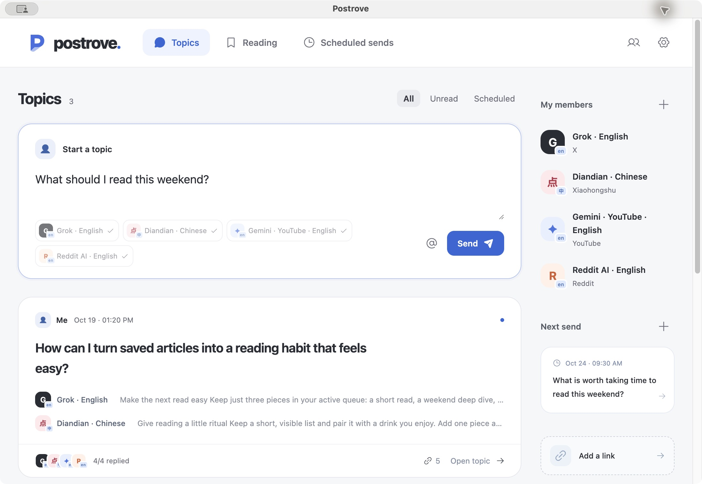
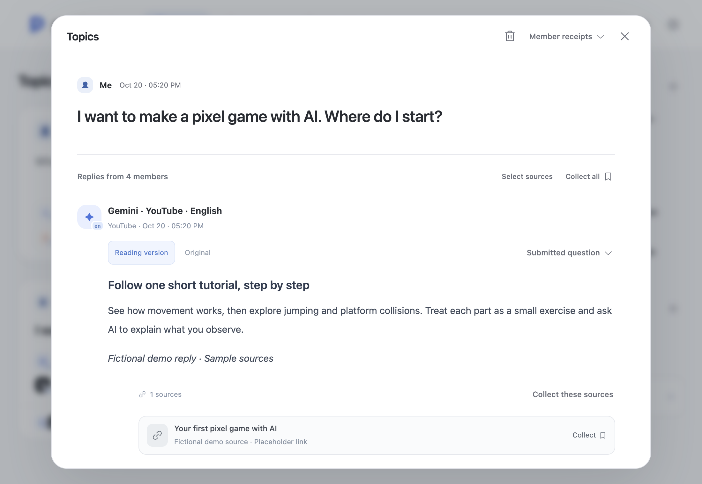
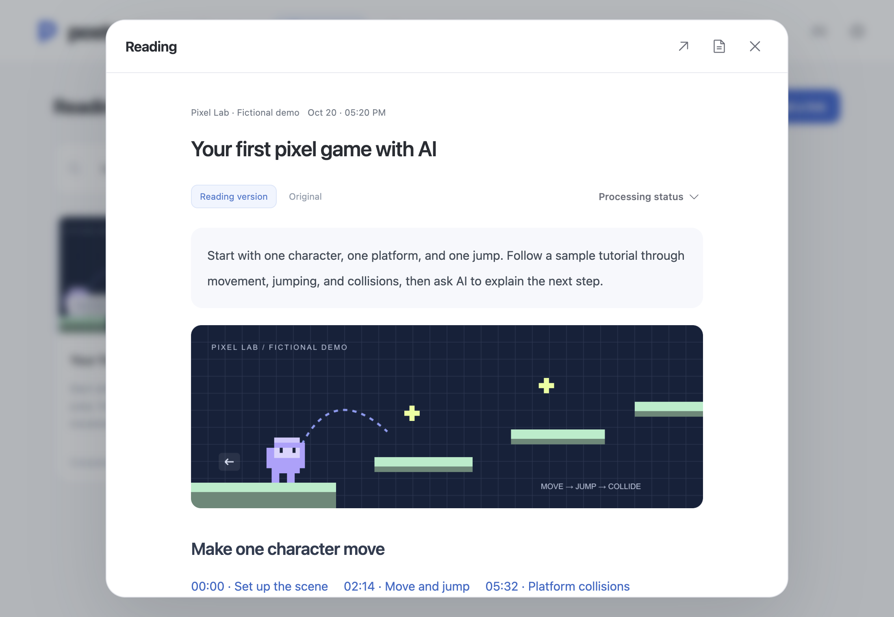
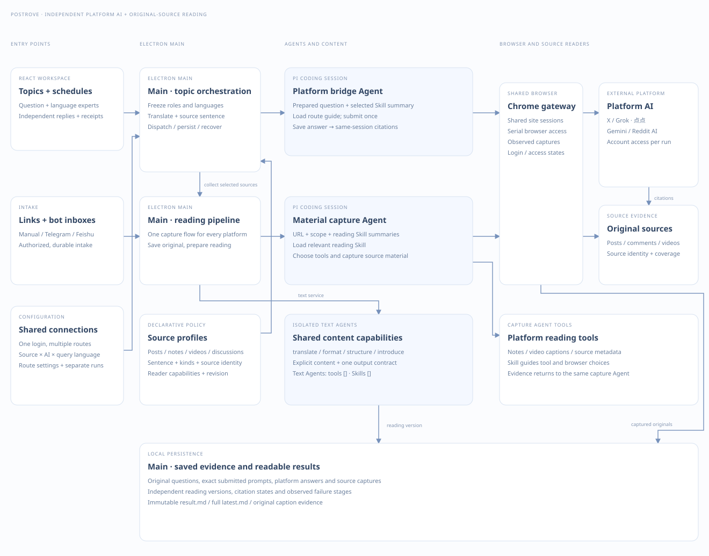

# Postrove

[简体中文](README.zh-CN.md)

Your AI members find the posts. Postrove helps you turn them into something worth reading.

Ask a question across platforms, compare independent replies, and save useful sources in one reading library. Automatic translation lets you ask and read in your own language.

[Download for macOS](https://github.com/huggon1/postrove/releases/latest) · [Download for Windows](https://github.com/huggon1/postrove/releases/latest) · [Getting started](#installation-and-use)

_Screenshots show the current source interface with fictional questions, replies, sources, and reading material. Published packages follow their release notes._

## Features

### Ask your AI members

Start a topic and choose its members. Each member answers independently with its platform's posts and sources. Open the topic to read its replies, inspect member receipts, and collect individual, selected, or all sources into Reading.

| Content platform | Platform AI            | Sign in to                        | Expert language  | Status       |
| ---------------- | ---------------------- | --------------------------------- | ---------------- | ------------ |
| X                | Grok                   | X                                 | Chinese, English | Integrated   |
| Xiaohongshu      | 点点                   | Xiaohongshu                       | Chinese          | Integrated   |
| YouTube          | Gemini                 | Gemini Apps with a Google account | Chinese, English | Experimental |
| Reddit           | Reddit AI search (Ask) | Optional: Reddit                  | English          | Experimental |

One platform sign-in can enable several language experts. Grok in Chinese and English share the same X connection; Gemini's YouTube experts share one Google sign-in.

Expert language is the language Postrove uses to communicate with that platform AI. It also influences the content the AI searches for.

Scheduled messages send a saved question daily or weekly while Postrove is open. Each occurrence creates its own topic.

### Ask in your language. Read in your language.

For example, ask in Chinese and choose the English Grok expert. Postrove translates your question into English, then prepares the reply in Chinese. The Chinese 点点 expert works the same way for an English-speaking reader.

Choose your reading language separately from the app language. Replies and collected material get a reading version, with the original text and links retained. Switch to the original whenever you want to compare.

### Collect content to read later

Collect posts and articles from different platforms in one place. Read their text, images, and summaries in your chosen language.

For example, when you find a long technical article you want to read later, forward its link to your configured Telegram or Feishu app bot. Postrove retrieves the content and prepares a summary, so you can skim the summary first and read the article later in the app. You can also add links directly.

Reading rules define the content to capture. The Agent loads the relevant Skill for the observed page. Other pages use the general web rule, with the Agent identifying the main content and how to read it.

| Page                          | Sign-in required    | Reading scope                                                                           | Skill / retrieval tool                                                                                                                 | Status     |
| ----------------------------- | ------------------- | --------------------------------------------------------------------------------------- | -------------------------------------------------------------------------------------------------------------------------------------- | ---------- |
| X post                        | Yes, X              | Post text, ordered images, quoted posts, and author-supplied material links             | [x-reading](src/platforms/browser/skills/x-reading/SKILL.md)                                                                           | Integrated |
| Xiaohongshu note              | Yes, Xiaohongshu    | Note title, text, and ordered image carousel                                            | [xiaohongshu-reading](src/platforms/browser/skills/xiaohongshu-reading/SKILL.md); optional `read_xiaohongshu` tool                     | Integrated |
| Public GitHub repository      | No                  | Default README, including code, tables, images, and links                               | [github-reading](src/platforms/browser/skills/github-reading/SKILL.md)                                                                 | Integrated |
| Public YouTube video          | No                  | Metadata, publicly accessible captions, timestamp links, and creator-supplied materials | [youtube-reading](src/platforms/browser/skills/youtube-reading/SKILL.md); available `read_youtube_transcript` tool and browser capture | Integrated |
| Public Reddit post or comment | No                  | Post body, or the selected comment with its parent post and necessary ancestor context  | [reddit-reading](src/platforms/browser/skills/reddit-reading/SKILL.md)                                                                 | Integrated |
| Other web pages               | Depends on the site | Accessible body, images, frames, and directly referenced materials                      | [web-reading](src/platforms/browser/skills/web-reading/SKILL.md)                                                                       | Integrated |

Skills define the reading scope; retrieval tools provide a source-specific way to fetch it. Both platform packages include `xiaohongshu-mcp` for the optional note reader, plus verified yt-dlp and Deno for YouTube captions. YouTube and Reddit readers follow the [platform expansion design](docs/platform-expansion-design.md).

Sign in to X or Xiaohongshu in Members; questions and content reading share that account. Partial retrieval keeps the available content and shows its coverage.

## Architecture

[Interactive architecture (download and open)](docs/architecture/index.html) · [Agent prompts and tools](docs/agent-prompt-flow.md) · [Saved Markdown results](docs/data-contracts.md#result-packages)

## Installation and use

| Platform              | Download                                                                     |
| --------------------- | ---------------------------------------------------------------------------- |
| macOS · Apple silicon | [GitHub Releases](https://github.com/huggon1/postrove/releases/latest) · DMG |
| Windows · x64         | [GitHub Releases](https://github.com/huggon1/postrove/releases/latest) · EXE |

1. Install Google Chrome.
2. Install Postrove. On macOS, open the DMG and move Postrove into Applications. Packages use a project signature; macOS may require System Settings → Privacy & Security → Open Anyway on first launch. On Windows, run the EXE installer and choose an installation directory. Windows installers are currently unsigned.
3. In Settings → Background models, create a connection, complete authentication, and select a model. Open Members to sign in to a platform and enable its language experts.
4. Start a topic or add a link in Reading. For bot forwarding, configure Telegram or Feishu and authorize your chat in Settings. Feishu supports official scan-to-create registration or an existing app with direct-message, sending, and history permissions.

Reports and website sessions are stored locally. Tasks send related questions and materials to your configured model. Both macOS and Windows support downloading and installing application updates through Settings → About.

## Account risk

> ⚠️ Postrove uses your signed-in platform accounts for automated search and content retrieval. These actions may trigger platform safeguards, leading to extra verification, rate limits, account restrictions, or bans. We recommend dedicated secondary accounts for X, Xiaohongshu, and other platforms to reduce the impact of account restrictions.

[Development guide](docs/development.md) · [0.1.0 release notes](docs/releases/0.1.0.md) · [Release guide](docs/releasing.md) · [MIT License](LICENSE)
