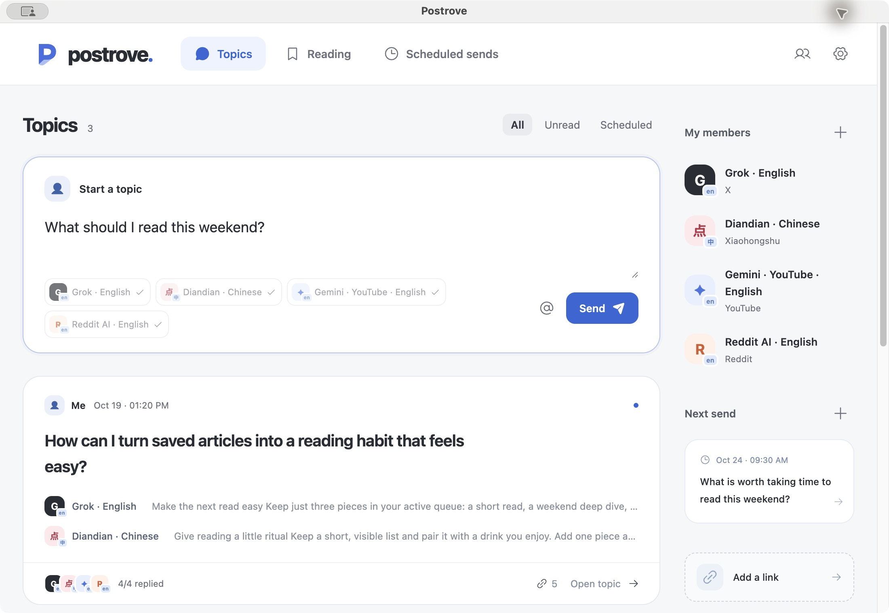
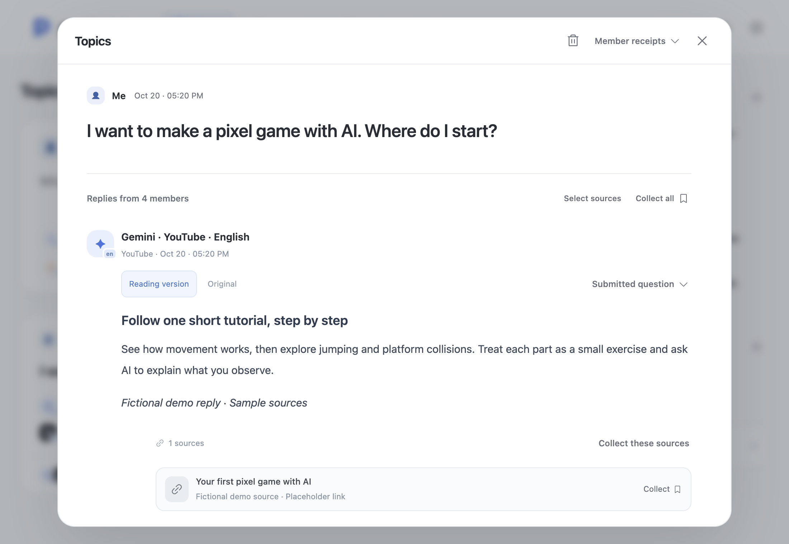
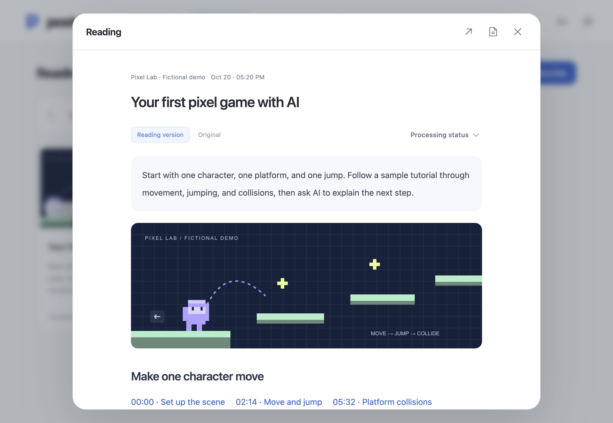
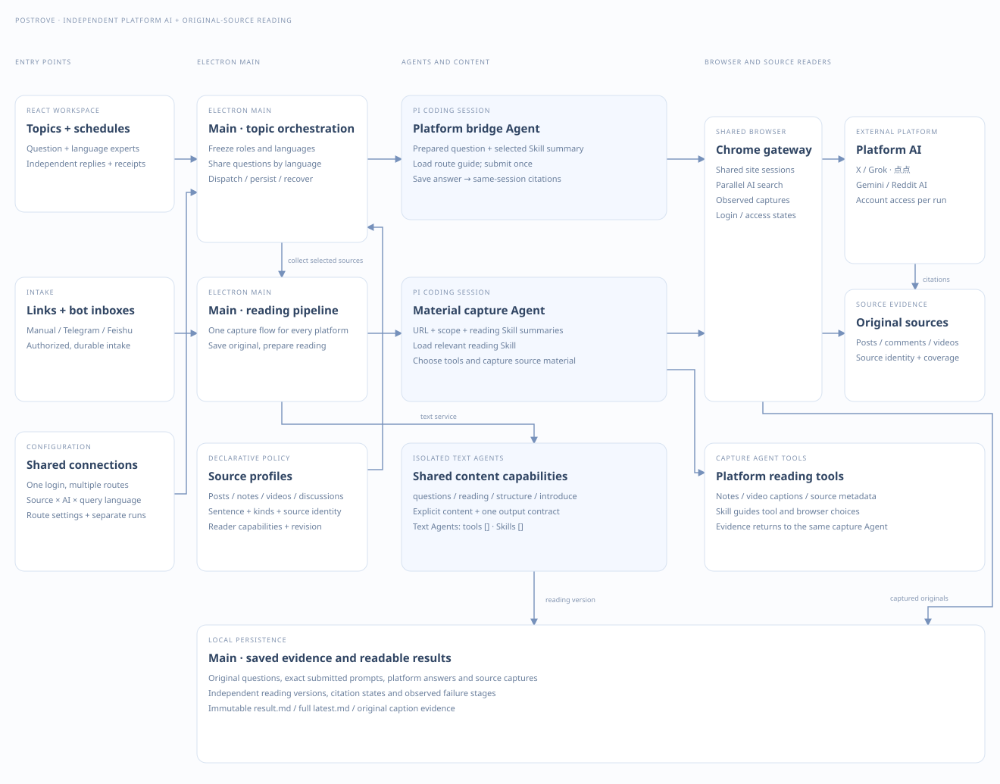

https://github.com/user-attachments/assets/7af81a37-5655-4a79-8722-bcda63cb5bf0

# Postrove

[简体中文](README.zh-CN.md)

Your AI members find the posts. Postrove helps you turn them into something worth reading.

Ask a question across platforms, compare independent replies, and save useful sources in one reading library. Automatic translation lets you ask and read in your own language.

[Website](https://huggon1.github.io/postrove/) · [Download for macOS](https://github.com/huggon1/postrove/releases/latest) · [Download for Windows](https://github.com/huggon1/postrove/releases/latest) · [Getting started](#installation-and-use)

_Screenshots show the current source interface with fictional questions, replies, sources, and reading material. Published packages follow their release notes._

## Features

### Ask your AI members

Start a topic and choose its members. Each member answers independently with its platform's posts and sources. Open the topic to read its replies, inspect member receipts, and collect individual, selected, or all sources into Reading.

| Content platform | Platform AI            | Sign in to                        | Expert language  | Status       |
| ---------------- | ---------------------- | --------------------------------- | ---------------- | ------------ |
| X                | Grok                   | X                                 | Chinese, English | Integrated   |
| Xiaohongshu      | 点点                   | Xiaohongshu                       | Chinese          | Integrated   |
| YouTube          | Gemini                 | Gemini Apps with a Google account | Chinese, English | Integrated   |
| Reddit           | Reddit AI search (Ask) | Optional: Reddit                  | English          | Integrated   |

One platform sign-in can enable several language experts. Grok in Chinese and English share the same X connection; Gemini's YouTube experts share one Google sign-in.

Expert language is the language Postrove uses to communicate with that platform AI. It also influences the content the AI searches for.

Scheduled messages send a saved question once, daily, on selected weekdays, monthly, or at a fixed minute or hour interval while Postrove is open. Set multiple times, a time zone, and date bounds, then preview the next sends. Each occurrence creates its own topic.

### Ask in your language. Read in your language.

For example, ask in Chinese and choose the English Grok expert. Postrove translates your question into English, then prepares the reply in Chinese. The Chinese 点点 expert works the same way for an English-speaking reader.

Choose your reading language separately from the app language. Replies and collected material get a reading version, with the original text and links retained. Switch to the original whenever you want to compare.

### Collect content to read later

Collect posts and articles from different platforms in one place. Read their text, images, and summaries in your chosen language.

For example, ask “I want to make a pixel game with AI. Where do I start?” Compare the members' replies, then collect a useful tutorial into Reading. You can also add its link directly or forward it to your configured Telegram or Feishu app bot. Postrove retrieves the available content and prepares a summary for later reading.

The reader’s copy icon copies the absolute `result.md` path for a coding agent. Browser addresses can be added with an omitted HTTPS prefix.

Reading rules define the content to capture. The Agent loads the relevant Skill for the observed page. Other pages use the general web rule, with the Agent identifying the main content and how to read it.

Base setup consists of a background model and Google Chrome. The table shows capabilities and additional setup on that basis. Settings → Capabilities shows current capabilities and opens the required setup.

| Platform | Reading with base setup | Capabilities added by further setup |
| --- | --- | --- |
| X | Publicly accessible post text, images, and quotations | Sign in for account-accessible content; enable experts for Grok |
| Xiaohongshu | Publicly accessible note text, images, and video metadata | Sign in for account-accessible notes and 点点; install the speech model to transcribe accessible video audio |
| YouTube | Video metadata, public captions, and timestamp links | Sign in to Google and enable experts for Gemini; install the speech model to transcribe accessible audio when captions are absent |
| Bilibili | Video metadata, accessible native captions, and part-specific timestamps | Sign in for account-accessible captions and media; install the speech model to transcribe accessible audio when captions are absent |
| Reddit | Public posts, selected comments, and required context; Reddit AI with an enabled English expert | Sign in for account-accessible community content |
| GitHub | Public repository default README | — |
| Other web pages | Accessible body, images, and directly referenced material | Use the site's session for account-accessible content |

Download the model in Settings → Speech to text. The application supplies the transcription components; installation shows actual download progress and supports cancellation and retry. The verified model stays local. YouTube and Bilibili prefer captions and use local transcription when captions are absent; Xiaohongshu video uses local transcription. Transcription covers spoken audio; visual content and text within frames retain unknown coverage. Source platforms determine sign-in, verification, and media access. Partial retrieval preserves the captured content and its coverage.

## Architecture

[Interactive architecture (download and open)](docs/architecture/index.html) · [Agent prompts and tools](docs/agent-prompt-flow.md) · [Saved Markdown results](docs/data-contracts.md#result-packages)

## Installation and use

| Platform              | Download                                                                     |
| --------------------- | ---------------------------------------------------------------------------- |
| macOS · Apple silicon | [GitHub Releases](https://github.com/huggon1/postrove/releases/latest) · DMG |
| Windows · x64         | [GitHub Releases](https://github.com/huggon1/postrove/releases/latest) · EXE |

1. Install Google Chrome.
2. Install Postrove. On macOS, open the DMG and move Postrove into Applications. Packages use a project signature; macOS may require System Settings → Privacy & Security → Open Anyway on first launch. On Windows, run the EXE installer and choose an installation directory. Windows installers are currently unsigned.
3. In Settings → Background models, create a connection, complete authentication, and select a model. Open Members to sign in to a platform and enable its language experts.
4. Start a topic or add a link in Reading. For bot forwarding, configure Telegram or Feishu and authorize your chat in Settings. Feishu supports official scan-to-create registration or an existing app with direct-message, sending, and history permissions.

Reports and website sessions are stored locally. Tasks send related questions and materials to your configured model. Both macOS and Windows support downloading and installing application updates through Settings → About.

## Account risk

> ⚠️ Postrove uses your signed-in platform accounts for automated search and content retrieval. These actions may trigger platform safeguards, leading to extra verification, rate limits, account restrictions, or bans. We recommend dedicated secondary accounts for X, Xiaohongshu, and other platforms to reduce the impact of account restrictions.

[Development guide](docs/development.md) · [0.2.3 release notes](docs/releases/0.2.3.md) · [Release guide](docs/releasing.md) · [MIT License](LICENSE)
