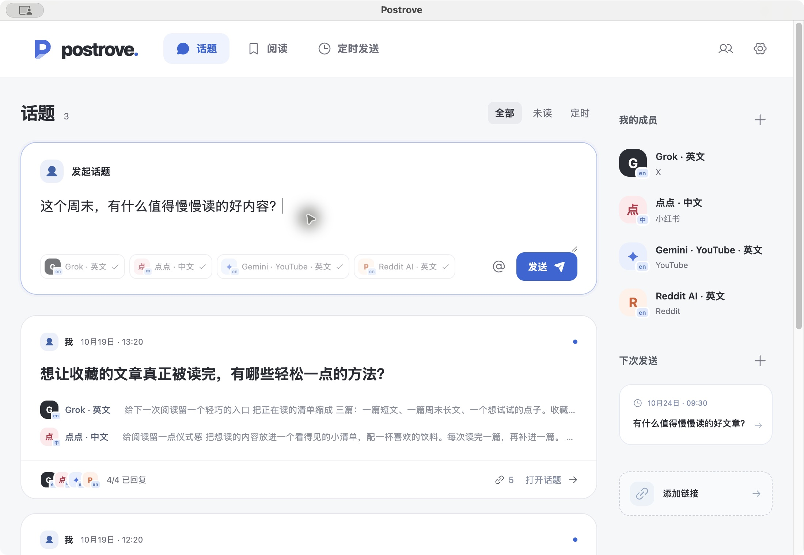
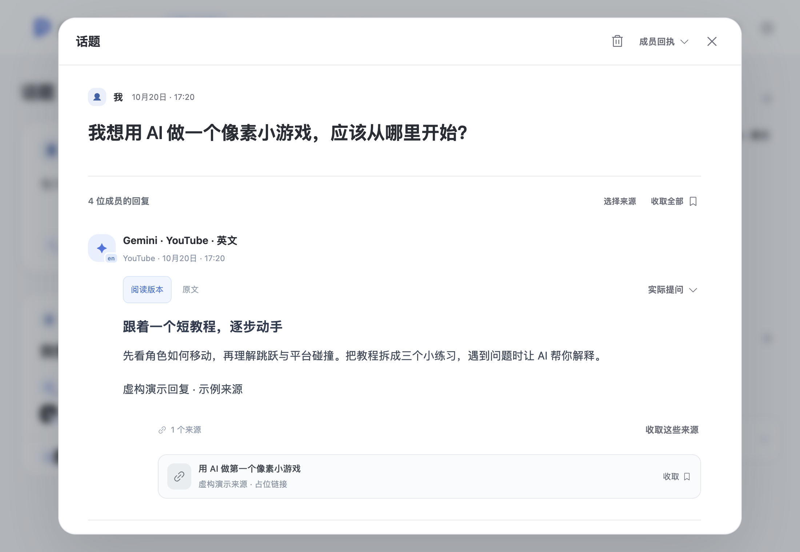
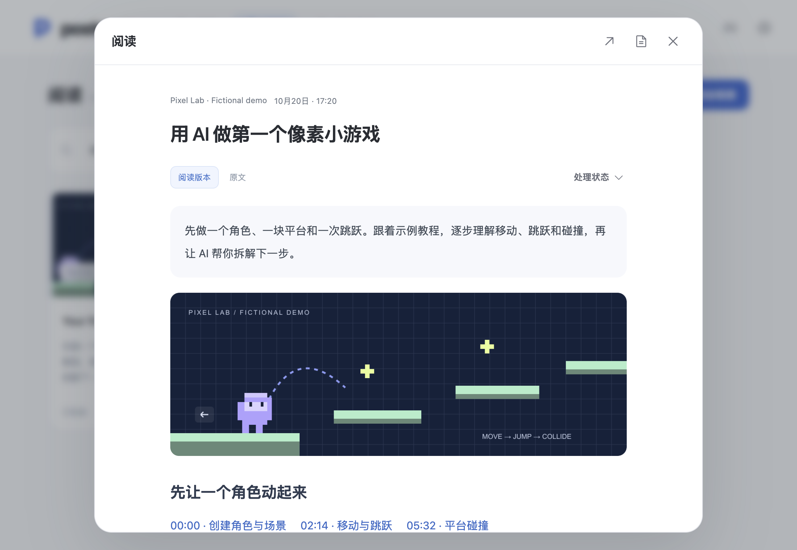
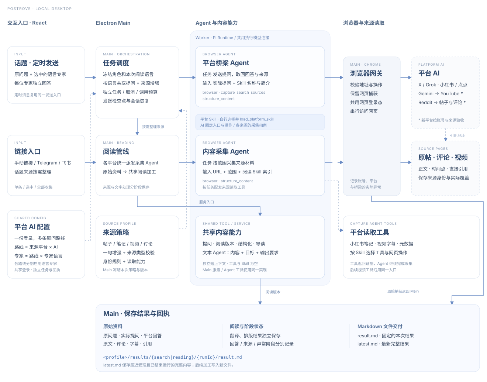

https://github.com/user-attachments/assets/467a0436-e65e-418c-9dd4-aad6e8d99e22

# Postrove

[English](README.md)

让平台 AI 帮你找内容，把值得读的内容留下来。

向不同平台的 AI 成员提出同一个问题，看看各自的回答，再把有用的来源收进阅读库。自动翻译让你用自己的语言提问，也用自己的语言阅读。

[官网](https://huggon1.github.io/postrove/?lang=zh-CN) · [下载 macOS 版](https://github.com/huggon1/postrove/releases/latest) · [下载 Windows 版](https://github.com/huggon1/postrove/releases/latest) · [开始使用](#安装与使用)

_截图使用虚构的问题、回答、来源和阅读材料，展示当前源码界面。安装包功能以对应版本说明为准。_

## 功能

### 向 AI 成员提问

发起一个话题，选择本次回答的成员。各成员独立回答，并附上平台帖子和来源。打开话题后，可以阅读回复、查看成员回执，按单条、选中或全部收集来源。

| 内容平台 | 平台 AI               | 登录站点                      | 专家语言   | 状态   |
| -------- | --------------------- | ----------------------------- | ---------- | ------ |
| X        | Grok                  | X                             | 中文、英文 | 已接入 |
| 小红书   | 点点                  | 小红书                        | 中文       | 已接入 |
| YouTube  | Gemini                | Gemini Apps，使用 Google 账号 | 中文、英文 | 试用   |
| Reddit   | Reddit AI 搜索（Ask） | 可选：Reddit                  | 英文       | 试用   |

同一次平台登录可以启用多位语言专家。Grok 中文和英文共用 X 连接，Gemini 的 YouTube 专家共用 Google 登录。

专家语言指应用与这位平台 AI 交流时使用的语言，也会影响它检索内容的倾向。

定时发送支持单次、每天、每周多个星期、每月和固定分钟或小时间隔。可以设置多个时间、时区和起止日期，并预览接下来的发送时间。应用运行时，每次发送创建一个新话题。

### 用自己的语言提问和阅读

比如用中文提问，选择 Grok 英文专家。Postrove 会将问题译成英文，再将回复转成中文。使用英文的读者向点点中文专家提问时，也会完成相应的翻译。

阅读语言可以单独设置。成员回复和收集的材料都会生成阅读版本，同时保留原文和链接，随时可以切回原文对照。

### 收集内容，稍后阅读

将各平台看到的感兴趣帖子和文章统一收集到 Postrove，以你选择的语言查看正文、图片和摘要。

比如提问“我想用 AI 做一个像素小游戏，应该从哪里开始？”，看看各成员的回答，再把有用的教程收进阅读库。也可以直接添加教程链接，或转发给配置好的 Telegram 或飞书应用机器人。Postrove 会读取可访问的内容并生成摘要，方便稍后阅读。

读取规则明确要采集的内容。Agent 按实际页面加载对应 Skill。其他页面使用通用网页规则，由 Agent 识别正文并选择读取方式。

| 页面                  | 需要登录       | 读取范围                                             | Skill / 读取工具                                                                                                               | 状态   |
| --------------------- | -------------- | ---------------------------------------------------- | ------------------------------------------------------------------------------------------------------------------------------ | ------ |
| X 帖子                | 是，登录 X     | 正文、按顺序排列的图片、引用帖子及作者提供的材料链接 | [x-reading](src/platforms/browser/skills/x-reading/SKILL.md)                                                                   | 已接入 |
| 小红书笔记            | 是，登录小红书 | 笔记标题、正文和按顺序排列的图片轮播                 | [xiaohongshu-reading](src/platforms/browser/skills/xiaohongshu-reading/SKILL.md)；可用时调用 `read_xiaohongshu`                | 已接入 |
| GitHub 公开仓库       | 否             | 默认 README，包含代码、表格、图片和链接              | [github-reading](src/platforms/browser/skills/github-reading/SKILL.md)                                                         | 已接入 |
| YouTube 公开视频      | 否             | 视频信息、公开字幕、时间点链接及作者提供的材料       | [youtube-reading](src/platforms/browser/skills/youtube-reading/SKILL.md)；可用时调用 `read_youtube_transcript`，结合浏览器采集 | 已接入 |
| Reddit 公开帖子或评论 | 否             | 帖子正文，或选中评论及其父帖和必要的上级评论         | [reddit-reading](src/platforms/browser/skills/reddit-reading/SKILL.md)                                                         | 已接入 |
| 其他网页              | 按网站要求     | 可访问的正文、图片、嵌入页面及直接引用材料           | [web-reading](src/platforms/browser/skills/web-reading/SKILL.md)                                                               | 已接入 |

Skill 约定读取范围，工具提供对应来源的获取方式。两端安装包均包含用于笔记读取的 `xiaohongshu-mcp`，以及已校验的 yt-dlp 和 Deno，用于读取 YouTube 字幕。YouTube 和 Reddit 的读取流程见[平台扩展设计](docs/platform-expansion-design.md)。

在成员管理中登录 X 或小红书后，提问和内容读取共用该账号。部分读取成功时，应用保留已获取的内容，并显示读取范围。

## 架构

[交互架构图（下载 HTML 后打开）](docs/architecture/zh-CN/index.html) · [Agent 提示词与工具](docs/agent-prompt-flow.md) · [Markdown 结果文件](docs/data-contracts.md#result-packages)

## 安装与使用

| 系统                  | 下载入口                                                                     |
| --------------------- | ---------------------------------------------------------------------------- |
| macOS · Apple silicon | [GitHub Releases](https://github.com/huggon1/postrove/releases/latest) · DMG |
| Windows · x64         | [GitHub Releases](https://github.com/huggon1/postrove/releases/latest) · EXE |

1. 安装 Google Chrome。
2. 安装 Postrove。macOS 用户打开 DMG，将 Postrove 拖入 Applications。安装包使用项目签名，首次打开时，macOS 可能要求在“系统设置 → 隐私与安全”中选择“仍要打开”。Windows 用户运行 EXE 安装程序并选择安装目录。Windows 安装程序当前未签名。
3. 在“设置 → 后台模型”中新建连接，完成认证并选择模型。打开成员管理，登录平台并启用语言专家。
4. 发起话题，或在阅读页添加链接。使用机器人转发时，先在设置中配置 Telegram 或飞书并授权聊天。飞书支持官方扫码创建应用，或连接具备单聊接收、发送和历史消息权限的已有应用。

报告和网站会话保存在本机。任务执行时，相关问题和材料会发送给配置的模型。macOS 和 Windows 均支持通过“设置 → 关于”下载并安装应用更新。

## 账号风险

> ⚠️ Postrove 使用已登录的平台账号执行自动搜索和内容读取。这类操作可能触发平台风控，导致额外验证、限流、账号限制或封禁。建议为 X、小红书等平台使用专用小号，以降低账号受限时的影响。

[开发指南](docs/development.md) · [0.2.1 发布说明](docs/releases/0.2.1.md) · [发布指南](docs/releasing.md) · [MIT 许可证](LICENSE)
